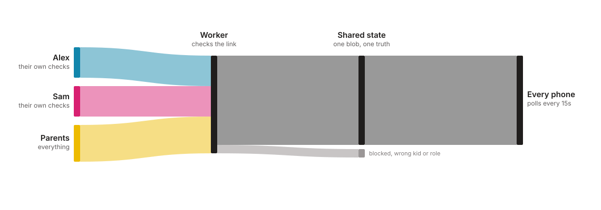
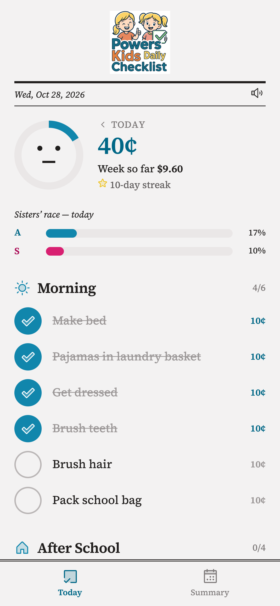
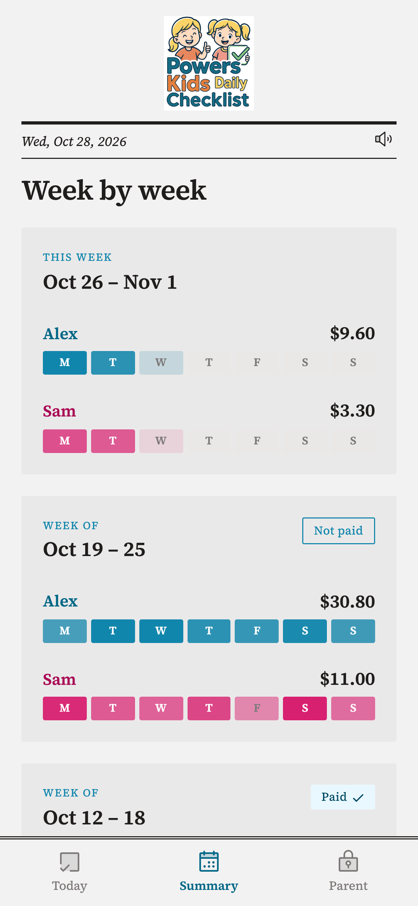
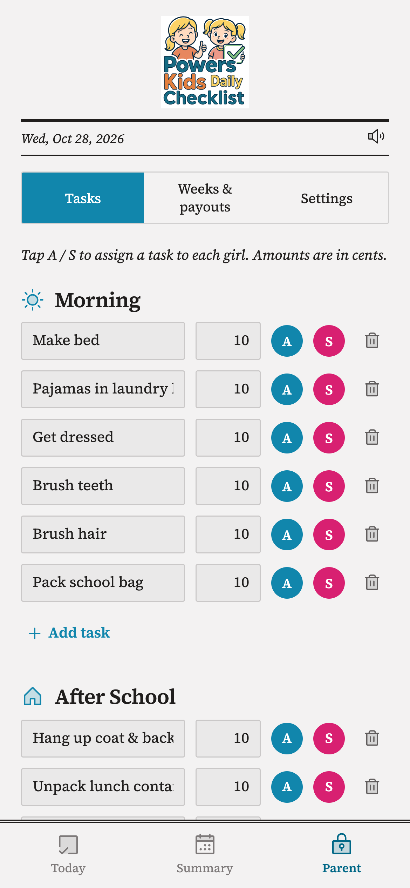
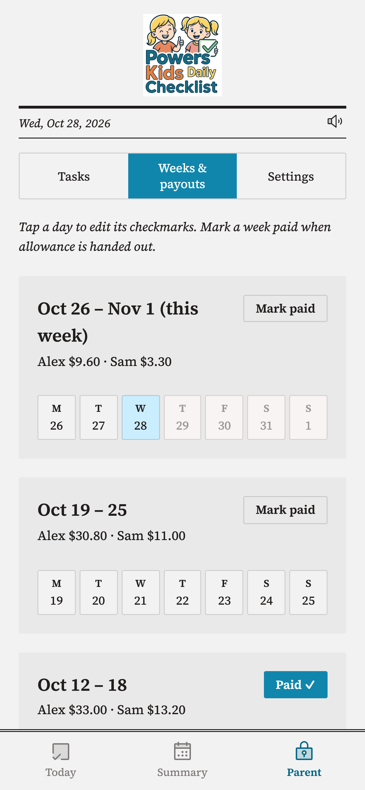

# Powers Kids Daily Checklist

A daily chore checklist and allowance tracker for a family with two kids.
Each kid checks off their own chores on their own phone, and every task earns
a small allowance amount. The parents manage the task list, set the amounts,
mark weeks as paid, and see a week-by-week earnings summary.

It is an installable PWA (React + Vite) backed by one small Cloudflare
Worker, so every phone in the house sees the same, accurate state. In this
public copy the two kids are called **Alex** and **Sam**, and the two parents
are **Parent** and **Partner**. Rename them to fit your own family.

## How it syncs

<picture>
  <source media="(prefers-color-scheme: dark)" srcset="docs/assets/how-it-syncs-dark.svg">
  
</picture>

There is no login and no PIN. Each person gets their own link, and the link
*is* the credential, enforced server-side by `worker/src/api.ts`.

- Every write goes to one shared JSON blob in Cloudflare KV, guarded by a
  revision counter. If two phones write at nearly the same moment, the second
  one gets the first one's fresh state back and quietly retries instead of
  overwriting it.
- Every phone re-checks the server every 15 seconds, and immediately when the
  app comes back to the foreground, so changes made elsewhere show up on
  their own.

See [`worker/CONTRACT.md`](worker/CONTRACT.md) for the full API.

## Roles

| Link | Can do |
|---|---|
| Alex's link (`ALEX_TOKEN`) | Check off Alex's own chores; view Today and Summary |
| Sam's link (`SAM_TOKEN`) | Check off Sam's own chores; view Today and Summary |
| Parent's link (`PARENT_TOKEN`) | Everything: either kid's checks, the task list, amounts, payouts, reset |
| Partner's link (`PARTNER_TOKEN`) | Same as Parent (role `admin`); two parents, two separate links |

A kid's link that tries to touch the other kid's row, or any admin action, is
refused by the server, not just hidden in the UI.

## What it looks like

The screenshots below use a demo dataset.

Every link opens on the **Today** view: that day's chores grouped into
sections, each worth a few cents, under a running total for the day and the
week so far, plus a small progress race between the two kids.



The **Summary** view shows a card per week with each kid's total and which
days they completed their chores, plus whether that week has been paid.



A parent's link unlocks the **Parent** view. Its Tasks tab is where chores get
created, renamed, repriced, assigned to one or both kids with the A and S
toggles, or deleted.



The Weeks and payouts tab lets a parent fix any day's checkmarks and mark a
week paid once the allowance has been handed out. A Settings tab changes the
per-task rate and can reset everything.



## Deploy your own

Full walkthrough, including security notes, is in
[`worker/SETUP.md`](worker/SETUP.md). The short version:

```bash
npm install && npm run build          # builds the app into dist/
cd worker && npm install
npx wrangler login
npx wrangler kv namespace create STATE   # paste the id into wrangler.jsonc
npx wrangler secret put ALEX_TOKEN       # repeat for SAM_TOKEN, PARENT_TOKEN, PARTNER_TOKEN
npx wrangler deploy
```

Then open `https://powers-kids-checklist.<your-subdomain>.workers.dev/<token>`
for each person and add it to their home screen. The first request seeds a
default chore list, which you can edit from the Parent view or in
`worker/src/ops.ts`.

To use your own kids' names, change `src/lib/kids.ts` (display names and
colors) and the kid ids in `src/lib/types.ts`, `worker/src/ops.ts`, and
`worker/src/api.ts`.

## Stack

**App** (repo root):
- React + TypeScript + Vite
- Plain CSS design tokens (`src/styles/tokens.css`)
- `@phosphor-icons/react` (duotone) for icons
- `@fontsource/source-serif-4`, self-hosted so the app does not depend on a
  font CDN
- Data lives on the server; `sound` is the only thing kept in `localStorage`,
  since it is a per-device preference, not shared state

**Backend** (`worker/`, its own sub-project):
- One Cloudflare Worker serves the built app's static files *and* the sync API
- One KV namespace holds the shared state as `{ rev, data }`
- Four tokens are Worker secrets; `/<token>` in the URL is both the link and
  the credential
- The test suite (`worker/test/`) covers the permission matrix, a genuine
  concurrent-write race, and bad-input handling

## Development

```bash
npm install
npm run dev      # Vite dev server (proxies /api to a local Worker on :8787)
npm run build    # typecheck + production build, output to dist/
```

To run the backend locally alongside it:

```bash
cd worker
npm install
npm test                   # worker test suite
npx wrangler dev --local   # serves on :8787, no Cloudflare account needed
```

## Project structure

```
src/
  App.tsx              # app shell: masthead, view switch, tab bar
  views/               # Today / Summary / Parent screens
  lib/                 # data model, sync client, derived-state helpers
  styles/tokens.css    # design tokens + component classes
worker/
  src/ops.ts           # pure checklist logic and the default task list
  src/api.ts           # /api/state, /api/mutate: routing, auth, permissions
  src/index.ts         # the real Worker: KV binding, static assets, routing
  test/                # the test suite
  CONTRACT.md          # the API contract the client is built against
  SETUP.md             # one-time Cloudflare setup, security notes
docs/assets/           # the sync diagram above, light and dark
docs/images/           # the screenshots above
docs/capture_screenshots.mjs   # regenerates screenshots from a live deployment
```

## Regenerating screenshots

`docs/capture_screenshots.mjs` shoots today.png, summary.png, and parent.png
from a live deployment:

```bash
cp .env.capture.example .env.capture   # then fill in a real per-person link
npm install --save-dev playwright
npx playwright install chrome
CAPTURE_URL=$(grep -v '^#' .env.capture | cut -d= -f2-) npm run capture
```

`.env.capture` is gitignored, because the link's last path segment is that
person's credential. Use a parent link if you want the Parent view in the
shot; a kid's link only reaches Today and Summary.
